# Li-ion-Battery-ECM-Model
This project focuses on the development and implementation of a lithium-ion battery 1-RC Thevenin equivalent circuit model using MATLAB. The main objective is to characterize behaviour, estimate internal parameters and validate the voltage response on multiple dynamic drive cycle tests. It features Pseudo OCV-SOC relationship, parameters estimation, static hystersis effect and validation.

## MODEL DEVELOPMENT
The modelling workflow consists of the following stages:

1- Experimental battery data processing. 
2- Pseudo OCV-SOC characterization. 
3- Battery parameter identification. 
4- Equivalent circuit model implementation. 
5- Dynamic drive cycle validation. 

## Repository Structure

- [`Data/`](Data/) - Experimental battery datasets
- [`model/`](model/) - Battery model implementation
- [`test/`](test/) - Model validation scripts
- [`Lookup/`](Lookup/) - Lookup tables
- [`plots/`](plots/) - Simulation plots
- [`Run_all.m`](Run_all.m) - Main execution script

## DATASET
This dataset presents the experimental campaign for a batch of eleven prismatic CALB L148N58A lithium-ion B-grade battery cells with a nominal capacity of 58 Ah. Particularly cell 59294 is used for the project with a testing temperature of 25°C.
Charging and discharging test are each done at C/20 and HPPC at 1C. 

Link: https://data.mendeley.com/datasets/ycx459r5c3/2

## PSEUDO OCV-SOC CHARACTERiSTICS
The dataset is not a perfect dataset for OCV-SOC characteristics as the no proper rest is given during testing for terminal voltage to fall near OCV. That's why a pseudo ocv-soc characterstics are obtained assuming at low rate C/20 terminal voltage is near equivalent to ocv.

Firstly two separate look-up are created for Charging and discharging with respect to terminal voltages. Then both are interpolated and the average of terminal voltages is taken to formulate OCV-SOC characteristics. A static hysteresis term(not corrected) is also added which at this stage is equivalent to half gap between charge and discharge curves. This will be corrected later on.

  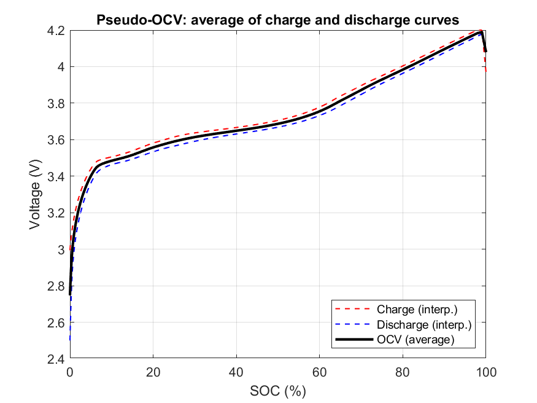
  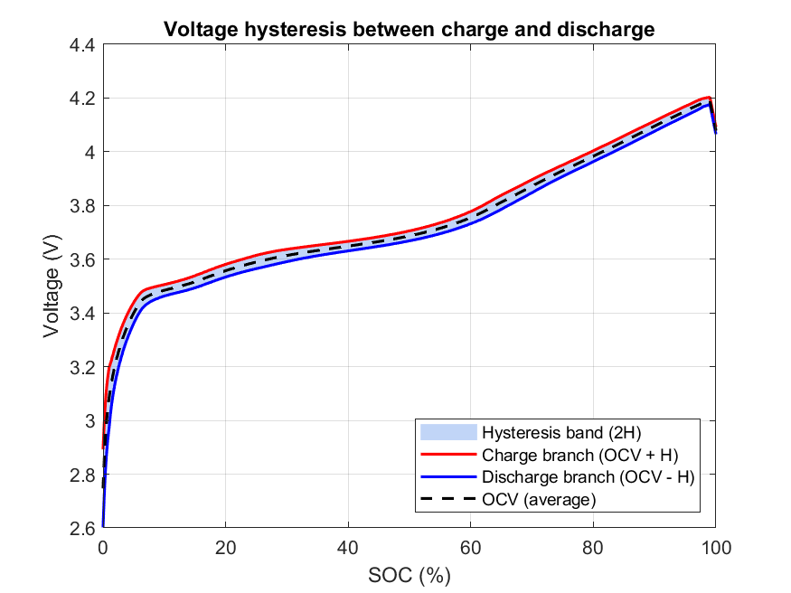

The discharge covers a slightly larger window than charge so the coulombic efficiency is calculated only over the same range for both.

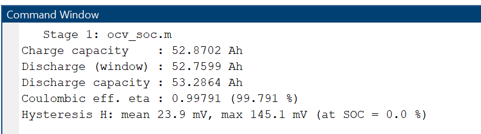

## PARAMETERS ESTIMATION
This utilize the HPPC(Hybrid Pulse Power Characterization) test to estimate the values of R0(electrolyte resistance), R1(diffusion/charge transfer resistance) and C1(double layer capacitance due to accumulation of ions on electrode) over the pulses by interpolating between them and extrapolating outside.

  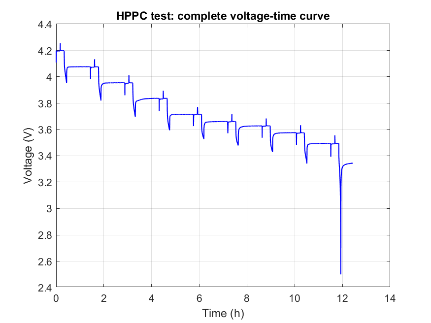
  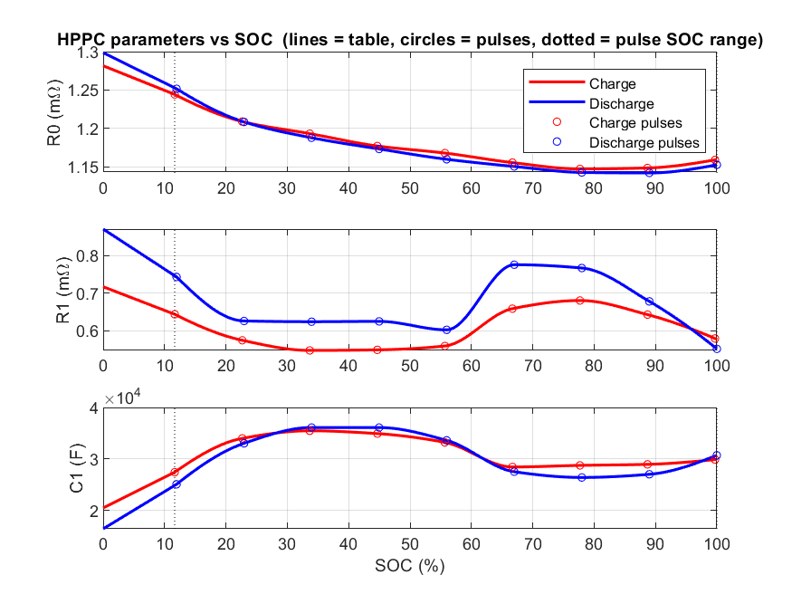

A scaled down look-up table is as follow:
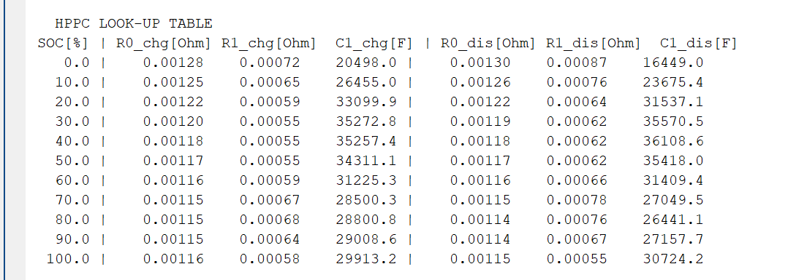

## MODEL IMPLEMENTATION 
A terminal-voltage calculation function is implemented to estimate the battery terminal voltage using the model parameters and internal states. Here the hysteresis is also corrected by removing the double counting effect.

V = OCV(SOC) + s*H(SOC) + R0*I + R1*I_R1     [accounted by sign of I and s]

## VALIDATION
The model is used to predict the terminal voltage corresponding to the given parameters from the tests and then this is compared to the actual voltage and error is computed. For better accuracy the starting SOC is calculated by reverse-counting rather then guessing. The end period of both test include a 90 minutes long rest period which is used to predict the SOC. "This uses information from the test itself, which makes the validation easier than a real use case".

### UDDS(Urban Dynamometer Driving Schedule) test
It is a city driving profile test and the results obtained are as follow:

  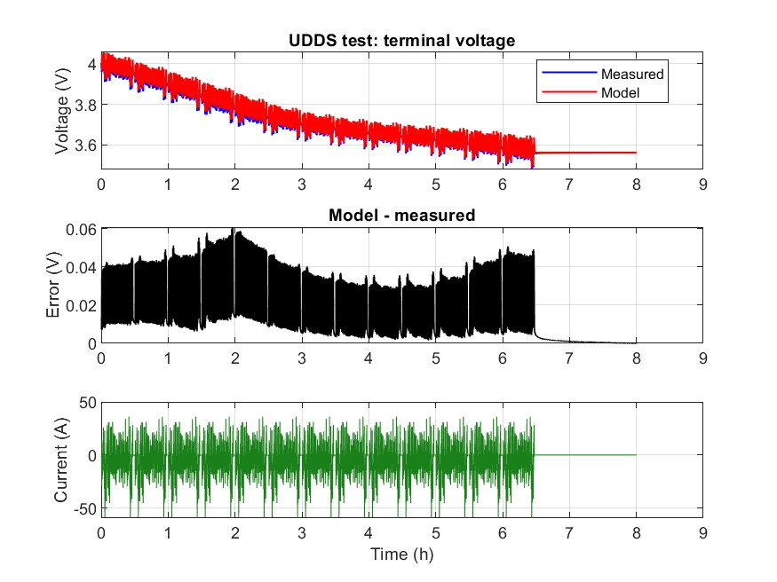
  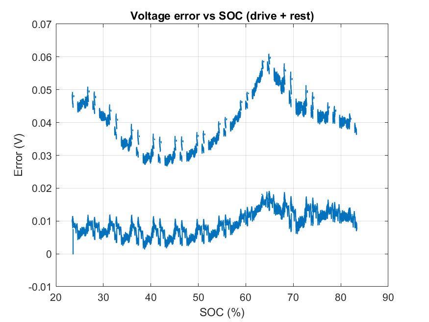

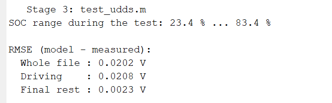

RMSE (Driving) : 0.0208V

### US06() test
It is a rigorous, highway driving test and the results obtained are as follow:

  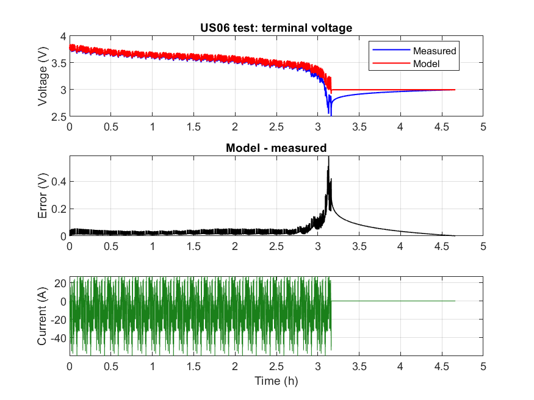
  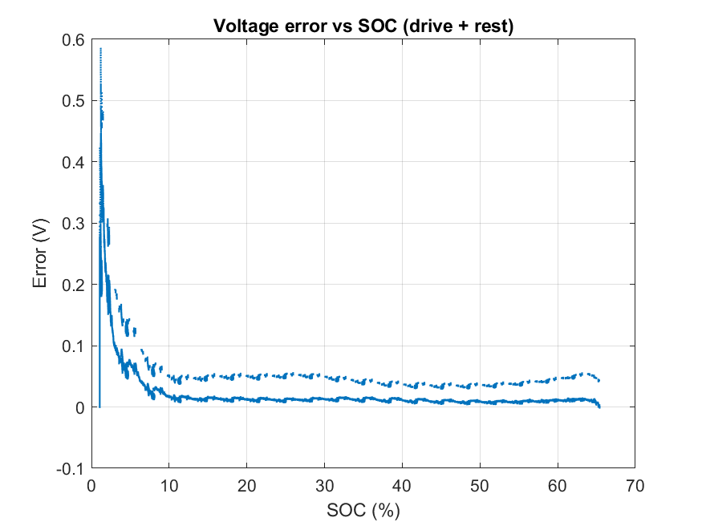

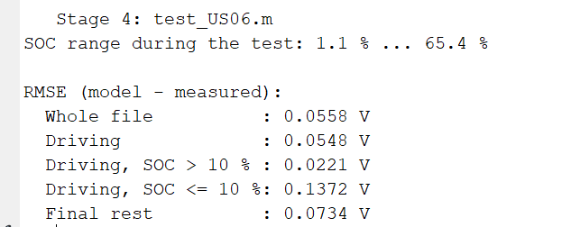

RMSE (Driving) : 0.0548V

## LIMITATIONS
Starting SOC is not available for Charging and Discharging dataset. So each is assumed to start at 0% (for charging) and 100% (for discharging). This gives pseudo OCV-SOC Characteristics and can introduce error in prediction.

## FUTURE SCOPE
1- Temperature-dependent battery modelling. 
2- Advanced SOC estimation techniques (EKF). 
3- Dynamic hysteresis inclusion. 
4- Battery SOH prediction. 
